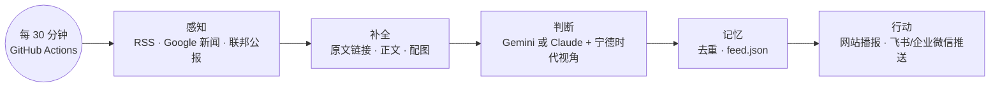

# 宁好 NingHao

**以宁德时代海外业务视角，实时解读全球储能、AI 数据中心与新能源政策的 AI 情报流。**

宁好不是新闻聚合器。它读完每一条新闻后回答一个问题：**这件事对宁德时代的海外生意意味着什么？**
然后把答案写成一张情报卡，附上原文配图和链接，有新消息就播报。

> 个人作品集项目，基于公开信息，不代表宁德时代官方立场。

---

## 它做什么

| 原文标题 | 宁好的标题 |
|---|---|
| PowerX signs pact with Energy Vault Japan on 1.5 GWh US BESS supply | 日本PowerX拟向美供1.5GWh储能，主打FEOC合规 |
| BMW Adds Samsung SDI, LG Energy Solution for Gen6 | 宝马Gen6电池扩充韩系供应商，美国份额给到LG |
| NTPC Green Energy tenders 10 GW/40 GWh of battery systems in India | 印度NTPC启动40GWh储能全球招标，指定LFP集装箱 |

每张情报卡包含：
- **分类**：项目动态、政策法规、财务披露、话事人发言、竞争格局、市场数据
- **信号与影响分**：机会、风险或中性，影响分 1–5
- **为什么重要**：和宁德时代海外业务的关系
- **原文要点**：只摘录原文里有的事实，不编造数字
- **建议动作**：给内部同事的一句话建议
- **原文**：原标题、来源、配图和链接，方便核对

## 工作原理



| 层 | 文件 | 用到的开源组件 |
|---|---|---|
| 感知 | `ninghao/fetch.py`、`config/sources.yaml` | feedparser、美国联邦公报 API |
| 补全 | `ninghao/enrich.py` | trafilatura（正文和 og:image）、googlenewsdecoder |
| 判断 | `ninghao/analyze.py`、`config/lens.md` | Google Gen AI SDK 或 Anthropic SDK（结构化输出），用 `NINGHAO_PROVIDER` 切换 |
| 记忆 | `ninghao/store.py` | 用 JSON 文件代替数据库，提交回仓库（git scraping 模式） |
| 行动 | `site/`、`ninghao/notify.py` | GitHub Pages；前端是纯 HTML/CSS/JS，无需构建 |

为什么这样设计，见 [docs/01_第一性原理.md](docs/01_第一性原理.md)。
想学 AI agent 怎么搭，见 [docs/02_AI-Agent入门.md](docs/02_AI-Agent入门.md)。

## 本地运行

```bash
python3 -m venv .venv
.venv/bin/pip install -r requirements.txt
```

只抓取、不调用模型，用来检查信息源是否正常：

```bash
.venv/bin/python -m ninghao.run --dry-run
```

正式运行。默认用 Gemini 的免费额度，key 在 [Google AI Studio](https://aistudio.google.com/apikey) 免费申请：

```bash
export GEMINI_API_KEY=你的key
.venv/bin/python -m ninghao.run --max 5
```

想换成 Claude：

```bash
export NINGHAO_PROVIDER=claude
export ANTHROPIC_API_KEY=你的key
.venv/bin/python -m ninghao.run --max 5
```

在本地预览网站：

```bash
python3 -m http.server 8000 --directory site
```

然后用浏览器打开 http://localhost:8000。

## 部署到 GitHub

分两个阶段。

**阶段一：私有仓库（手动运行，本地演示）**

1. 在仓库的 **Settings → Secrets and variables → Actions → Secrets** 里添加 `GEMINI_API_KEY`。想用 Claude 的话，改加 `ANTHROPIC_API_KEY`，并在 **Variables** 里加 `NINGHAO_PROVIDER`，值为 `claude`。
2. 打开 **Actions → 宁好 · 抓取、分析与发布 → Run workflow**，手动运行一次。新情报会存回仓库。
3. 在本地 `git pull`，再按上面「本地运行」的方法打开网页。

这个阶段不开定时任务，也不发布网站：免费账号的私有仓库每月只有 2000 分钟 Actions 额度，而且用不了 GitHub Pages。

**阶段二：公开上线（定时播报，网址可分享）**

1. 把仓库改成公开（**Settings → General → Danger Zone → Change visibility**）。
2. 在 **Settings → Pages** 里，把 Source 设为 **GitHub Actions**。
3. 在 **Settings → Secrets and variables → Actions → Variables** 里添加变量 `NINGHAO_PAGES`，值为 `true`。
4. 在 `.github/workflows/ninghao.yml` 里删掉 `schedule` 两行开头的 `#`，提交并推送。

之后每 30 分钟会自动运行一次。新情报会存回仓库，网站会自动更新；页面每分钟检查一次，有新内容就弹出提示。

**可选：推送到群聊。** 添加 `NOTIFY_WEBHOOK_URL` 密钥，填飞书或企业微信群机器人的 webhook 地址。影响分 ≥ 4 的情报会推送到群里。

## 定制

- **加信息源**：在 `config/sources.yaml` 里加一段，不用改代码。
- **改判断标准**：改 `config/lens.md`。这份文件就是宁好的「岗位说明书」，会原样放进模型的系统提示词。
- **换模型**：
  - `NINGHAO_PROVIDER`：`gemini`（默认）或 `claude`。
  - `NINGHAO_MODEL`：不设就用默认模型，Gemini 是 `gemini-3.5-flash-lite`，Claude 是 `claude-opus-5-5`。
  - `NINGHAO_EFFORT`：只对 Claude 生效，可选 `low`、`medium`、`high`，默认 `medium`。
  - 在 GitHub Actions 里，同名的仓库变量（Variables）也能生效。

## 费用

每条新闻调用一次模型。

- **Gemini（默认）**：用免费额度，不花钱。免费额度有每分钟和每天的上限，具体数字以 [Google AI Studio](https://aistudio.google.com) 里你账号的限额页为准。宁好一条一条地分析，遇到每分钟限流会等一会儿再试；当天额度用完，剩下的条目留到下次运行。免费层的输入可能被 Google 用来改进产品，宁好处理的都是公开新闻，影响不大。
- **Claude**：判断质量更高。用 Claude Opus 5.5、medium 推理强度，大约 2–3 美分一条；每天处理 50–100 条新内容，约 1–3 美元。

两个控制用量的设计：
- 关键词预筛：明显无关的条目不会交给模型。
- `max_new_per_run` 限制每次运行最多分析多少条。

GitHub Actions 和 Pages 对公开仓库免费；私有仓库每月有 2000 分钟免费 Actions 额度，手动运行用不完。

## 已知局限

- Energy-Storage.news 等少数网站拒绝程序抓取正文，这类条目只能根据标题和摘要判断，也没有配图（页面会显示分类占位图）。
- GitHub 的定时任务可能延迟几分钟，所以是「近实时」，不是秒级。
- 首批 18 条示例情报是开发时离线生成的，详情页会标注「种子数据」。接上 API key 运行后，会被正式分析的结果替换。

## 声明

标题与解读由 AI 生成，可能有误，请以原文为准。配图通过原媒体链接直接显示，版权归原媒体所有。
